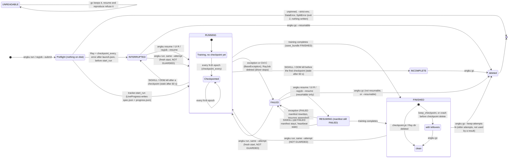
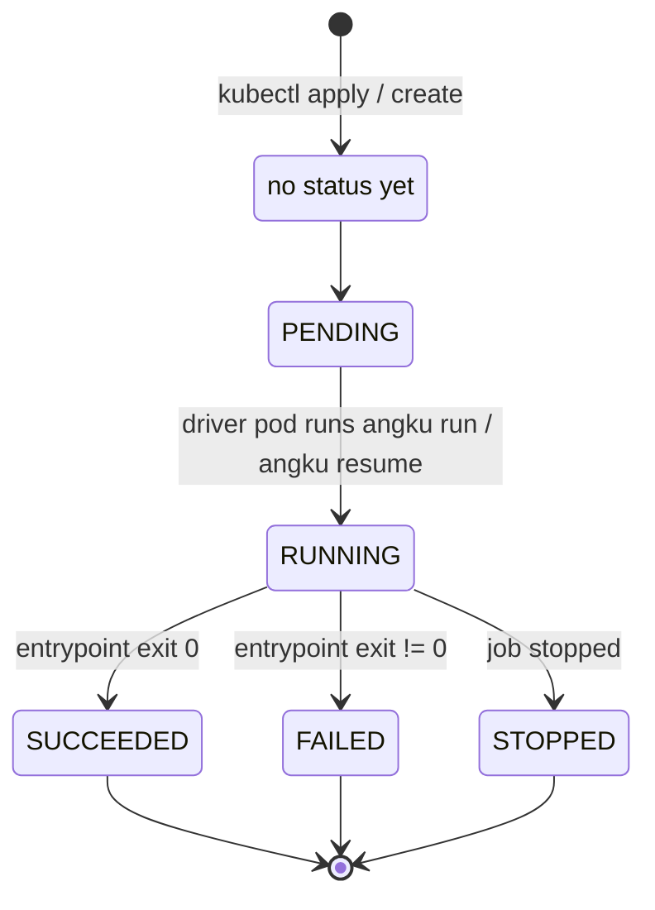
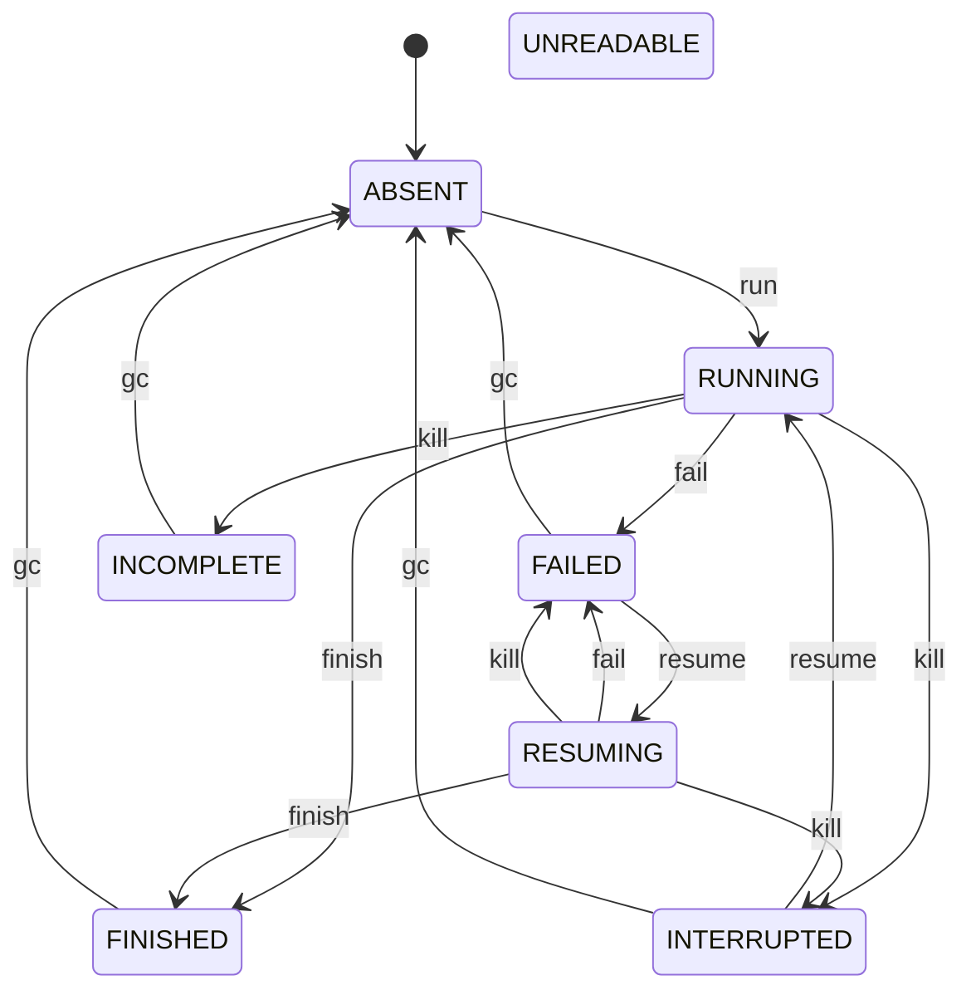

# Run lifecycle

What a run goes through from `angku run` to `angku gc`. There is no `angku launch` command: a run is
started by `angku run` (local or `--launcher ray`) or by `angku rayjob --submit`, whose pod runs
`angku run --launcher ray`.

A run is one `run_id` = sha256(experiment_id, resources, attempt). Its state is never stored as one
value: it is derived from which files exist under `<artifacts>/<run_id>/`, the manifest's `status`,
the heartbeat in `progress.json`, and, for Ray, directories in Ray storage and the RayJob's status.

The first diagram is the lifecycle as it was found (commit 8cc10ab); the lists below it were written
against that code and say what has been fixed since. The [target lifecycle](#target-lifecycle) is what
the code enforces now: `domain/run_state.py` `derive_state` is the one state function, and
`application/lifecycle.py` `ALLOWED_TRANSITIONS` is the one table every run and resume refusal goes
through.

## Before (as found at 8cc10ab)

`angku reproduce`, `report`, `diff`, `list`, `predict`, `ensemble` and the UI only read a run: they cause
no transition on it. `reproduce` writes its replay into a separate scratch store.

KubeRay adds a second, independent state machine (the RayJob's `jobStatus`, as seen by `kuberay.py`):

`RayJobStatus.finished` = SUCCEEDED / FAILED / STOPPED; anything else counts as active for
`active_rayjobs`. Deleting a RayJob is not a state here: the RayJob is gone, and its bundle ends FAILED.

## Target lifecycle

Node names are `RunState` values, edge labels are `Event` values: `tests/test_lifecycle.py` parses this
diagram and requires it to equal `ALLOWED_TRANSITIONS` edge for edge. Deleted by gc = `ABSENT` again.

- `run` (`angku run`, `rayjob --submit`, `run_experiment`, `RayLauncher.launch`) only from `ABSENT`:
  anything already in `<run_id>/` (a `spec.json` or a `manifest.json`) is refused, exit 2, with a hint to
  pick a new `--attempt` (and `angku resume` when the run is resumable). There is no `--force`.
  `rayjob --submit` can check only with `--artifacts DIR` (this machine's view of the artifacts PVC); the
  pod's own `angku run` refuses in any case.
- `resume` only from `FAILED` with a checkpoint (-> `RESUMING`) and `INTERRUPTED` (-> `RUNNING`).
- `finish` happens only once the bundle has landed: the launchers write the FINISHED bundle first and
  tell the tracker FINISHED after; a failed bundle write tells it FAILED.
- `kill` (SIGKILL, OOM, power loss, or a bundle write that fails) is not a command: the heartbeat goes
  stale after `STALE_AFTER`. A killed resume of a FAILED run keeps its old FAILED manifest, unless it
  was killed while writing its FINISHED bundle: that write drops the old manifest first, so the run is
  INTERRUPTED (its checkpoint is still there) rather than FAILED next to fresh weights.
- A FAILED bundle drops any `model.pt` / `best.pt` an earlier, killed bundle write left behind.
- `gc` conditions (resumable runs only with `--resumable`, FINISHED only with `--keep-attempts`, runs used
  by a result never) are gc's policy on top of the table. Removing FINISHED leftovers is not a transition.
- `UNREADABLE` takes no command; `RUNNING` and `RESUMING` take none either.

Where each state is decided:

| State | Rule in `derive_state` |
|---|---|
| ABSENT | no `spec.json` and no `manifest.json` |
| UNREADABLE | `spec.json` or `manifest.json` does not parse (or a newer format), or a manifest without `spec.json` |
| RUNNING | no manifest, `progress.json` running and fresher than `STALE_AFTER` |
| RESUMING | FAILED manifest, `progress.json` running and fresh |
| FINISHED | FINISHED manifest (a fresh heartbeat next to it does not change that) |
| FAILED | FAILED manifest, no live progress |
| INTERRUPTED | no manifest, no live progress, `checkpoint.pt` or `launch.json` |
| INCOMPLETE | no manifest, no live progress, no checkpoint |

`resumable` = `FAILED` or `INTERRUPTED` with `checkpoint.pt` / `launch.json` (`is_resumable`).

## How each state is represented (before)

| State | Files in `<artifacts>/<run_id>/` | Other signals |
|---|---|---|
| Preflight | none (`angku run` without `--artifacts`: never anything) | process alive; RayJob may already exist |
| RUNNING | `spec.json`, `progress.json` (`state: running`, `updated` within 60 s), no `manifest.json` | tracker run RUNNING; Ray: driver alive, RayJob RUNNING |
| Checkpointed (sub-state) | + `checkpoint.pt` (local) or `launch.json` (Ray) | Ray: `storage/angku-<run_id[:12]>-a<attempt>/checkpoint_*` |
| RESUMING | `manifest.json` with `FAILED` + live `progress.json` | was listed FAILED; now its own state (target) |
| FINISHED | `manifest.json` `status: FINISHED`, `model.pt` (+ `best.pt`, `split.json`, `report.md`) | tracker FINISHED; RayJob SUCCEEDED |
| FAILED | `manifest.json` `status: FAILED`, no `model.pt` | tracker FAILED; RayJob FAILED |
| resumable (flag) | `checkpoint.pt` or `launch.json`, and status not FINISHED | Ray: the `checkpoint_*` dirs (not checked by listing) |
| INTERRUPTED | `spec.json` + (`checkpoint.pt` or `launch.json`), no manifest, no live progress | |
| INCOMPLETE | `spec.json`, no manifest, no checkpoint, no live progress | |
| UNREADABLE | `spec.json` or `manifest.json` does not parse, or a newer `format_version` | |
| deleted | directory gone (`LocalArtifactStore.delete` prunes empty dirs) | Ray dir deleted too with `--ray-storage` |

## Implicit states (exist in the code, never represented)

Status after the target lifecycle in **bold**.

1. **Preflight / queued.** Before `tracker.start_run` there is nothing on disk. A RayJob that is
   PENDING (cluster starting, image pulling) has no files either: `angku list` and the UI's Runs screen
   do not show the run, and `angku resume` cannot tell that a job for it is about to start.
2. **Resuming a FAILED run.** **Fixed: `RESUMING`.** Only `progress.json` says it is running again; the manifest still says
   FAILED until the resumed segment ends. Listing has no state for it (see contradictions, 1).
3. **Checkpointed vs not.** Whether a kill ends INTERRUPTED or INCOMPLETE depends on whether the first
   checkpoint landed; while the run is live nothing shows which one it is (RUNNING has no `resumable`).
4. **Writing the bundle.** `save_bundle` writes `spec.json`, `split.json`, `model.pt`, `best.pt`, then
   `manifest.json`. A crash in between leaves weights without a manifest, listed INCOMPLETE or
   INTERRUPTED; gc then deletes the weights.
5. **Finishing.** Between the FINISHED manifest and the end of the CLI there are steps with no state of
   their own: `checkpoint.pt` / Ray dir delete, `report.md`, `progress.json` delete. A crash there
   leaves FINISHED with leftovers, or a FINISHED run with no `report.md`.
6. **`progress.json` `state: ended`.** Written by `LiveProgress.end_run`, deleted by the CLI right
   after. `is_live` only looks for `running`, so `ended` is never read; it is only visible if the CLI
   dies in that window, or when a launcher is used outside the CLI.
7. **Reproduced / verified.** A successful `angku reproduce` leaves no trace on the original run.
   Whether a run has ever been verified is not recorded anywhere.
8. **Retry lineage.** Attempts of one experiment are separate runs. Nothing records that attempt 2
   is a retry of a failed attempt 1; the user picks `--attempt` by hand.
9. **Used by a result.** "Protected from gc" is derived from every `result.json`'s `members`, not
   stored on the run.

## Transitions that look wrong but are not prevented

Status after the target lifecycle in **bold**.

1. **Re-running a FINISHED run (same `--attempt`).** **Fixed: `run` only from `ABSENT`.** `cmd_run`, `run_experiment` and
   `RayLauncher.launch(resume=False)` never check for an existing bundle. The new process:
   - overwrites `spec.json` and `progress.json` at once. While it trains the run is listed FINISHED,
     because the manifest wins; `predict` / `reproduce` / `ensemble` keep reading the old bundle.
   - if it fails, writes a FAILED manifest next to the old run's `model.pt` (and `best.pt`). The
     result is a FAILED bundle with weights, which breaks "FAILED = no weights".
   - if it finishes without `--keep-best` where the old run had one, the old `best.pt` stays with
     `manifest.best = None`. `predict` then picks that stale `best.pt` (it chooses by file presence),
     and `reproduce` compares it against a replay with no `best.pt` -> NOT REPRODUCED.
   - opens a second MLflow run with the same `angku.run_id` tag (`start_run(resume=False)`); a later
     resume searches by that tag.
2. **Fresh `angku run` over a FAILED or INTERRUPTED run (same `--attempt`).** **Fixed: refused, the
   message points at `angku resume`.** It starts from epoch 1
   while the old `checkpoint.pt` stays until FINISHED. If the new process runs without
   `--checkpoint-every` and is killed, the run lists INTERRUPTED + resumable. `angku resume` then
   continues from the *old* process's checkpoint (same run_id, so the check passes), with the old
   segment's environment record.
3. **Two writers on one run.** **Known issue (below).** Only `_resume_target` (CLI `resume`, UI `R`) refuses a live run. Two
   `angku run` with the same attempt, or `run` while a resume is live, both write `progress.json`,
   checkpoints and the manifest; the last write wins. `angku rayjob --submit` without `--resume`
   does not call `active_rayjobs`, so a second RayJob of a running run is not refused.
4. **Local `angku resume` of a Ray run whose RayJob is still active.** **Known issue (below).** The check uses only the
   heartbeat; `active_rayjobs` is consulted only by `rayjob --resume --submit`. A PENDING job (no
   heartbeat yet) or a driver whose heartbeat is stale can race the resume.
5. **Staleness compares two clocks.** **Known issue (below).** `updated` is written with the writer's clock (the pod),
   `is_live` uses the reader's (the laptop running `list` / `gc` / `resume`). With clock skew over
   60 s, a live run looks INTERRUPTED (resume and `gc --resumable` allowed), or a dead one looks live.
6. **Library callers without `LiveProgress`.** **Open** (a second `run` is refused now; `resume` and
   `gc --resumable` still see INTERRUPTED). `run_experiment(..., artifacts=, checkpoint_every=)`
   called outside the CLI writes no `progress.json`. After the first checkpoint the live run lists
   INTERRUPTED, so `angku resume` and `angku gc --resumable` will act on it.
7. **Ray ghost resumable.** **Open.** With `checkpoint_every`, `RayLauncher` writes `spec.json` + `launch.json`
   before `tracker.start_run` and before any Ray checkpoint exists. A failure there, or a Ray run that
   fails before its first checkpoint, is listed resumable, but resume is refused ("no Ray checkpoint").
8. **Resume refusals live in the launchers and the CLI, not in one place.** **Fixed: every run and resume
   refusal is `lifecycle.require` over `ALLOWED_TRANSITIONS`.** FINISHED is refused in
   `_resume_point`, `_refuse_if_finished` and `_resume_target`; the live check only in
   `_resume_target`. A new caller of `Launcher.launch(resume=True)` gets the first rule but not the
   second.

## One state, several representations that can disagree

Status after the target lifecycle in **bold**.

1. **Is it running?** **Fixed for listing, gc, resume and the UI: all read `derive_state`, which has
   `RESUMING`.** The tracker and the RayJob still answer on their own. `progress.json` (fresh heartbeat), `manifest.json` (absent), the tracker's run
   status, and the RayJob's `jobStatus`. Listing lets the manifest win, gc lets the heartbeat win. For a
   resumed FAILED run, `list` and the UI say FAILED, gc says "live", and UI `R` refuses because it is
   running.
2. **Is it resumable?** **Open (Ray storage).** Local: `checkpoint.pt` in the artifacts. Ray: `launch.json` in the artifacts
   stands in for `checkpoint_*` directories in Ray storage, which listing never looks at. `launch.json`
   stays after a Ray run finishes and after its Ray dir is deleted; Ray storage can be gone (another
   machine, PVC wiped) while the run is listed resumable.
3. **Did it finish?** **Fixed: bundle first, then the tracker; a failed bundle write ends the tracker
   run FAILED.** The tracker's `end_run("FINISHED")` happens *before* `save_bundle`. If the
   bundle write fails (disk full, PVC unmounted), MLflow says FINISHED, the CLI prints "run FAILED"
   and exits 1, and the artifacts have no manifest (INCOMPLETE / INTERRUPTED). On KubeRay the RayJob
   then reads FAILED.
4. **Bundle files vs manifest.** **Fixed for new runs (the overwrite that caused it is refused); bundles
   written before can still hold it.** `status` says FAILED but `model.pt` may exist (transition 1 above);
   `manifest.best` is None but `best.pt` may exist. Readers pick by file presence (`load_bundle`,
   `predict`) or by manifest field (`reproduce` criterion, report), so they can disagree.
5. **Kept checkpoint vs leftover.** **Open.** `--keep-checkpoint` is not recorded in the manifest. A FINISHED
   run with a kept `checkpoint.pt` looks the same as one that crashed before deleting it, and
   `angku gc` deletes both.
6. **RayJob vs bundle.** **Open** (FAILED no longer means only the bundle write failed). STOPPED or deleted -> bundle FAILED (graceful) or INTERRUPTED (hard kill);
   FAILED can mean training failed or only the bundle write failed (3). The UI shows RayJobs and runs
   on separate screens, joined only by the `angku.io/run` label (first 32 hex of the run_id).
7. **Attempt.** **Open.** Lives in the run_id, `--attempt`, `manifest.attempt`, `checkpoint.pt`, `launch.json`,
   the Ray run name (`-a<attempt>`) and the RayJob name. They are consistent by construction, but
   listing reads it from the manifest only, so INTERRUPTED / RUNNING runs show `a?` even though their
   checkpoint knows it. `epochs_done` is likewise None for INTERRUPTED although `checkpoint.pt`
   records the epoch.
8. **History.** **Open.** `manifest.history` = every epoch; `progress.history` = only the current process's
   epochs (a resume starts empty) while `progress.epoch` is absolute; the tracker holds every epoch,
   minus re-logs (Ray restores don't re-log).

## Known issues (not addressed)

Concurrent writers and clock skew are out of scope for the target lifecycle: every guard above reads
the store, decides, then acts, with no lock in between.

1. **Two writers on one run.** Two processes can both pass `require` before either writes (two
   `angku run` with the same attempt started together, or a `run` / `resume` racing a resume). After
   the first one's `start_run`, the second is refused; before it, both proceed and the last write wins.
   `rayjob --submit` without `--resume` still does not ask `active_rayjobs`.
2. **`angku resume` of a Ray run whose RayJob is still active.** `require` looks at the heartbeat only.
   A PENDING RayJob (no heartbeat yet) or a driver whose heartbeat went stale can race the resume;
   only `rayjob --resume --submit` consults `active_rayjobs`.
3. **Clock skew.** `progress.updated` is the writer's clock, `derive_state`'s `now` the reader's. A
   skew over `STALE_AFTER` (60 s) makes a live run look INTERRUPTED / FAILED (so `resume` and
   `gc --resumable` act on it) or a dead one look RUNNING / RESUMING.
