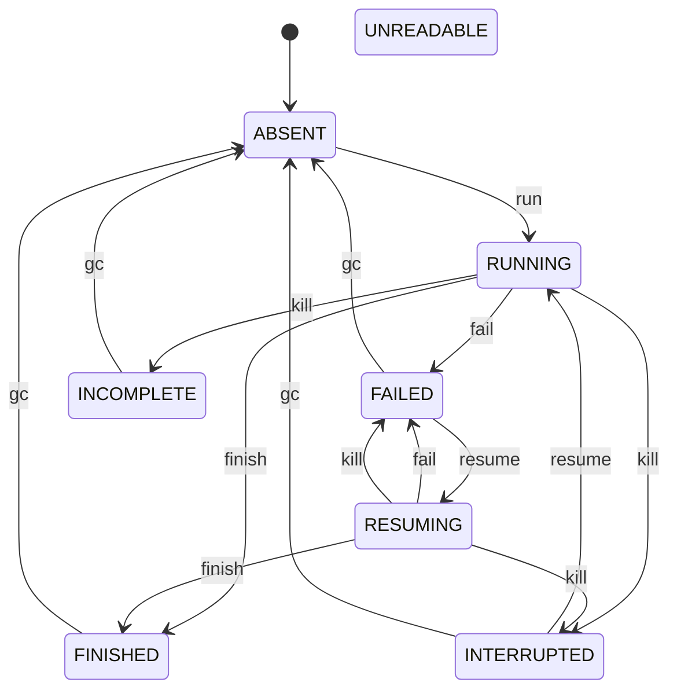
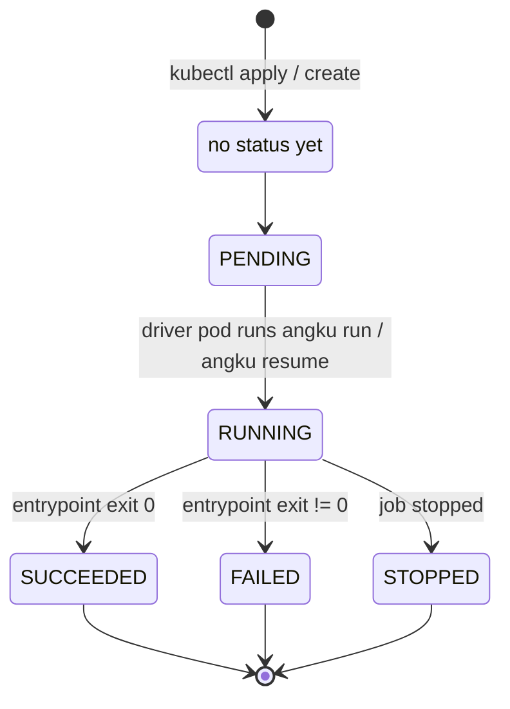

# Run lifecycle

What a run goes through from `angku run` to `angku gc`. A run is started by `angku run` (local or
`--launcher ray`) or by `angku rayjob --submit`, whose pod runs `angku run --launcher ray`.

A run is one `run_id` = sha256(experiment_id, resources, attempt). Its state is never stored as one
value: `domain/run_state.py` `derive_state` derives it from which files exist under
`<artifacts>/<run_id>/`, the manifest's `status` and the heartbeat in `progress.json`.
`application/lifecycle.py` `ALLOWED_TRANSITIONS` is the one table every run and resume refusal goes
through.

## Target lifecycle

Node names are `RunState` values, edge labels are `Event` values: `tests/test_lifecycle.py` parses this
diagram and requires it to equal `ALLOWED_TRANSITIONS` edge for edge. Deleted by gc = `ABSENT` again.

- `run` (`angku run`, `rayjob --submit`, `run_experiment`, `RayLauncher.launch`) only from `ABSENT`:
  anything already in `<run_id>/` (a `spec.json` or a `manifest.json`) is refused, exit 2, with a hint to
  pick a new `--attempt` (and `angku resume` when the run is resumable). There is no `--force`.
  `rayjob --submit` can check only with `--artifacts DIR` (this machine's view of the artifacts PVC); the
  pod's own `angku run` refuses in any case.
- `resume` only from `FAILED` with a checkpoint (-> `RESUMING`) and `INTERRUPTED` (-> `RUNNING`).
- `finish` happens only once the bundle has landed: the launchers write the FINISHED bundle first and
  tell the tracker FINISHED after; a failed bundle write tells it FAILED.
- `kill` (SIGKILL, OOM, power loss, or a bundle write that fails) is not a command: the heartbeat goes
  stale after `STALE_AFTER`. A killed resume of a FAILED run keeps its old FAILED manifest, unless it
  was killed while writing its FINISHED bundle: that write drops the old manifest first, so the run is
  INTERRUPTED (its checkpoint is still there) rather than FAILED next to fresh weights.
- A FAILED bundle drops any `model.pt` / `best.pt` an earlier, killed bundle write left behind.
- `gc` conditions (resumable runs only with `--resumable`, FINISHED only with `--keep-attempts`, runs used
  by a result never) are gc's policy on top of the table. Removing FINISHED leftovers is not a transition.
- `UNREADABLE` takes no command; `RUNNING` and `RESUMING` take none either.
- `angku reproduce`, `report`, `diff`, `list`, `predict`, `ensemble` and the UI only read a run: they
  cause no transition on it. `reproduce` writes its replay into a separate scratch store.

Where each state is decided:

| State | Rule in `derive_state` |
|---|---|
| ABSENT | no `spec.json` and no `manifest.json` |
| UNREADABLE | `spec.json` or `manifest.json` does not parse (or a newer format), or a manifest without `spec.json` |
| RUNNING | no manifest, `progress.json` running and fresher than `STALE_AFTER` |
| RESUMING | FAILED manifest, `progress.json` running and fresh |
| FINISHED | FINISHED manifest (a fresh heartbeat next to it does not change that) |
| FAILED | FAILED manifest, no live progress |
| INTERRUPTED | no manifest, no live progress, `checkpoint.pt` or `launch.json` |
| INCOMPLETE | no manifest, no live progress, no checkpoint |

`resumable` = `FAILED` or `INTERRUPTED` with `checkpoint.pt` / `launch.json` (`is_resumable`).

## RayJob status

KubeRay adds a second, independent state machine (the RayJob's `jobStatus`, as seen by `kuberay.py`):

`RayJobStatus.finished` = SUCCEEDED / FAILED / STOPPED; anything else counts as active for
`active_rayjobs`. Deleting a RayJob is not a state here: the RayJob is gone, and its bundle ends FAILED
(graceful stop) or INTERRUPTED (hard kill).

## Known issues

Concurrent writers and clock skew are out of scope for the target lifecycle: every guard reads the
store, decides, then acts, with no lock in between.

1. **Two writers on one run.** Two processes can both pass `require` before either writes (two
   `angku run` with the same attempt started together, or a `run` / `resume` racing a resume). After
   the first one's `start_run`, the second is refused; before it, both proceed and the last write wins.
   `rayjob --submit` without `--resume` does not ask `active_rayjobs`.
2. **`angku resume` of a Ray run whose RayJob is still active.** `require` looks at the heartbeat only.
   A PENDING RayJob (no heartbeat yet) or a driver whose heartbeat went stale can race the resume;
   only `rayjob --resume --submit` consults `active_rayjobs`.
3. **Clock skew.** `progress.updated` is the writer's clock, `derive_state`'s `now` the reader's. A
   skew over `STALE_AFTER` (60 s) makes a live run look INTERRUPTED / FAILED (so `resume` and
   `gc --resumable` act on it) or a dead one look RUNNING / RESUMING.
4. **Library callers without `LiveProgress`.** `run_experiment(..., artifacts=, checkpoint_every=)`
   called outside the CLI writes no `progress.json`. After the first checkpoint the live run derives as
   INTERRUPTED, so `angku resume` and `angku gc --resumable` will act on it (a second `run` is refused).
5. **Ray ghost resumable.** With `checkpoint_every`, `RayLauncher` writes `spec.json` + `launch.json`
   before `tracker.start_run` and before any Ray checkpoint exists. A failure there, or a Ray run that
   fails before its first checkpoint, is listed resumable, but resume is refused ("no Ray checkpoint").
   More generally, `launch.json` stands in for the `checkpoint_*` dirs in Ray storage, which listing
   never looks at: Ray storage can be gone while the run is listed resumable.
6. **Kept checkpoint vs leftover.** `--keep-checkpoint` is not recorded in the manifest. A FINISHED run
   with a kept `checkpoint.pt` looks the same as one that crashed before deleting it, and `angku gc`
   deletes both.
7. **Attempt and epochs of a run without a manifest.** Listing reads `attempt` and `epochs_done` from the
   manifest only, so INTERRUPTED runs show `a?` and no epochs although their checkpoint knows both.
8. **Three histories.** `manifest.history` = every epoch; `progress.history` = only the current process's
   epochs (a resume starts empty) while `progress.epoch` is absolute; the tracker holds every epoch,
   minus re-logs (Ray restores don't re-log).
9. **Bundles written before this table.** A FAILED bundle with `model.pt`, or a `best.pt` with
   `manifest.best = None`, can still exist from re-runs the old code allowed. Readers pick by file
   presence (`load_bundle`, `predict`) or by manifest field (`reproduce`, report), so they can disagree.
